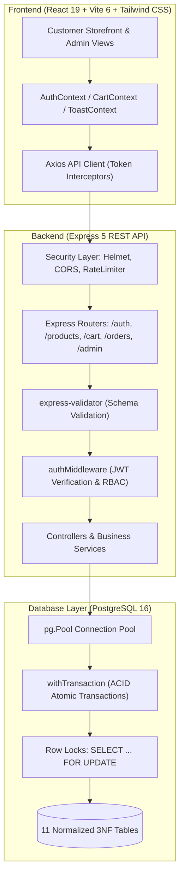

# KoraMarket — Full-Stack E-commerce Platform

[](https://nodejs.org)
[](https://expressjs.com)
[](https://www.postgresql.org)
[](https://react.dev)
[](https://vite.dev)
[](https://tailwindcss.com)
[](https://github.com/swale4126-bit/codealpha_tasks)

> **CodeAlpha Full-Stack Development Internship — Task 1: Simple E-commerce Store**  
> **Author & Developer:** Swaleh M. ([GitHub: @swale4126-bit](https://github.com/swale4126-bit/codealpha_tasks))  
> **Repository:** [`codealpha_tasks/Simple-E-commerce-Store`](https://github.com/swale4126-bit/codealpha_tasks/tree/main/Simple-E-commerce-Store)

---

## 1. Project Overview

**KoraMarket** is a production-minded full-stack e-commerce web platform engineered using a modern client-server architecture with **React 19**, **Vite 6**, **Tailwind CSS v4**, **Node.js (ES Modules)**, **Express 5**, and a normalized **PostgreSQL 16** relational database.

The application delivers an end-to-end shopping journey: from storefront product browsing, full-text search, multi-facet filtering, product reviews, persistent cart syncing (guest `localStorage` + PostgreSQL merge upon login), to an atomic checkout engine with row-level stock locks, and a role-protected administrative suite with live business intelligence telemetry.

---

## 2. Key Modules & Feature Highlights

### A. Customer Storefront (20 Modules)
1. **Homepage Experience:** Hero banners, value proposition badges, category discovery grids, and curated featured picks.
2. **Responsive Navigation:** Sticky header with live search, animated cart drawer trigger with counter badge, user account dropdown, and mobile navigation drawer.
3. **Product Catalog:** Paginated catalog supporting grid views with badges for discounts, out-of-stock items, and low-stock alerts.
4. **Product Department Navigation:** Deep-linked category routing with live product counts.
5. **Debounced Search:** Sub-350ms debounced full-text search across product titles, SKUs, and descriptions synced to URL search parameters.
6. **Multi-Facet Filtering:** Filter products by category, price floor/ceiling, minimum rating, stock availability, and featured picks.
7. **Multi-Criteria Sorting:** Sort by newest arrival, price (low-to-high, high-to-low), and highest customer rating.
8. **Product Details:** High-resolution image gallery carousel with thumbnail selection, stock indicators, and related product recommendations.
9. **Interactive Customer Reviews:** 1-to-5 star ratings, structured customer reviews, and ownership-protected review deletion.
10. **Dual-Mode Shopping Cart:** Full offline cart for guest visitors persisted in browser `localStorage`.
11. **Automatic Cart Merge:** Seamlessly merges guest shopping carts into PostgreSQL upon login, respecting live stock limits.
12. **Live Stock Cap Safeguards:** Prevents adding more units than live warehouse stock.
13. **Sliding Cart Drawer:** Slide-out drawer with quantity modifiers, line item deletions, free shipping progress bar, and instant subtotal recalculations.
14. **Dedicated Cart Page:** Full-page cart overview with cost breakdown and one-click transition to checkout.
15. **User Registration & Login:** JWT authentication with bcrypt password hashing (12 salt rounds) and automatic cart initialization.
16. **User Profile & Password Management:** Update full name, phone number, and change passwords with current-password verification.
17. **Shipping Address Book:** Multi-address management with recipient name, phone, street, city, state, postal code, and default selection.
18. **Atomic Checkout Engine:** Sub-transaction order placement with row-level inventory locking (`FOR UPDATE`), freezing order items, shipping snapshots, and cart flushing.
19. **Simulated Payment / Cash on Delivery:** Choice between Cash on Delivery (COD) and Simulated Demo Card (Test Mode) with full visual receipt.
20. **Order Tracking & Cancellation:** Customer order history with timeline tracking (`pending` → `confirmed` → `processing` → `shipped` → `delivered`) and self-cancellation for pending orders with automatic stock restoration.

### B. Administrative Operations Hub (10 Modules)
1. **Role-Based Access Control (RBAC):** All admin routes and views are strictly guarded by `requireAuth` + `requireAdmin` middleware.
2. **Operations Dashboard:** Live KPI cards (Gross Revenue, Total Orders, Active Customers, Low-Stock Alerts), order pipeline counters, and 30-day sales timeline visualization.
3. **Department Revenue Breakdown:** Category distribution bars and top-performing products ranked by sales volume.
4. **Order Fulfillment Hub:** Filter store orders by status or search by customer name/email, with inline status dropdown to advance shipping states.
5. **Order Inspection Drawer:** Detailed modal displaying shipping address snapshots, customer notes, item lists, and financial totals.
6. **Product Catalog Management:** Full inventory table with status indicators (Active vs Archived), image previews, and direct filters.
7. **Product Creation & Editing Modal:** Add or update titles, slugs, categories, SKU codes, pricing, compare-at pricing, stock quantities, and descriptions.
8. **Inventory Restocking Safeguard:** Quick-restock inline triggers with warehouse alerts.
9. **Safeguarded Product Removal:** Hard-deletes products that have never been ordered; automatically soft-archives products with order history to preserve historical sales records.
10. **Customer Administration & Access Control:** View customer directory with total orders and lifetime spending; toggle account status (Active / Suspended) with safety checks preventing self-deactivation.

---

## 3. Technology Stack

| Layer | Technologies Used |
|---|---|
| **Frontend** | React 19, Vite 6, Tailwind CSS v4, React Router 7, Axios, Context API, Lucide React Icons |
| **Backend** | Node.js (ES Modules), Express 5, `pg` (node-postgres connection pool), JSON Web Tokens (`jsonwebtoken`), `bcryptjs`, `express-validator`, `helmet`, `cors`, `morgan`, `express-rate-limit` |
| **Database** | PostgreSQL 16 (Third Normal Form - 3NF, 11 entities, foreign keys, triggers, constraints, indexes) |
| **Testing** | Node.js Test Runner (`node:test`, `node:assert/strict`), Supertest |
| **Environment** | Windows 10/11, Git, Visual Studio Code / Antigravity |

---

## 4. Architecture & Workflow



### Relational Database Schema (11 Entities in 3NF)
1. `users` — Authentication credentials, roles (`customer`, `admin`), active status.
2. `addresses` — Customer shipping destinations with default address enforcement.
3. `categories` — Product taxonomy and departments.
4. `products` — Base catalog records, pricing, SKU codes, stock levels, and low-stock limits.
5. `product_images` — Image gallery with primary image flags and display order.
6. `carts` — 1:1 persistent cart containers for registered shoppers.
7. `cart_items` — Cart line items with unique `(cart_id, product_id)` constraints.
8. `orders` — Immutable order headers with frozen `shipping_address_snapshot` (JSONB) and financial totals.
9. `order_items` — Frozen order line items with immutable snapshots of price, name, and SKU at purchase time.
10. `payments` — COD or Simulated Demo Card payment states (1:1 with orders).
11. `reviews` — 1-to-5 star ratings and reviews with 1 review per user-product constraint.

---

## 5. Development Environment & Setup Guide

### Prerequisites
- **Node.js:** v18.x or v20+ (tested on Node.js v24)
- **npm:** v9+ or v10+
- **PostgreSQL:** v14, v15, or v16 running locally on port `5432`

---

### Step 1: Clone the Repository
```powershell
git clone https://github.com/swale4126-bit/codealpha_tasks.git
cd codealpha_tasks/Simple-E-commerce-Store
```

---

### Step 2: Database Initialization (PostgreSQL)
Ensure your PostgreSQL service is running, then execute the schema and seed scripts:

```powershell
# Create the database (if not already created)
psql -U postgres -c "CREATE DATABASE koramarket;"

# Apply the normalized schema (11 tables, constraints, indexes)
psql -U postgres -d koramarket -f database/schema.sql

# Seed initial categories, realistic products, images, and user accounts
psql -U postgres -d koramarket -f database/seed.sql
```

---

### Step 3: Backend Configuration & Server Setup
1. Navigate to the `server/` directory and install dependencies:
   ```powershell
   cd server
   npm install
   ```

2. Configure environment variables by copying `.env.example`:
   ```powershell
   cp .env.example .env
   ```

3. Ensure `server/.env` contains your PostgreSQL credentials:
   ```ini
   PORT=5000
   NODE_ENV=development
   CLIENT_URL=http://localhost:5173
   DB_HOST=localhost
   DB_PORT=5432
   DB_NAME=koramarket
   DB_USER=postgres
   DB_PASSWORD=YOUR_POSTGRES_PASSWORD
   JWT_SECRET=super_secret_jwt_key_koramarket_2026_production_safe
   JWT_EXPIRES_IN=7d
   ```

4. Start the Express development server:
   ```powershell
   npm run dev
   ```
   The backend API will start on **`http://localhost:5000`**. You can verify health by visiting `http://localhost:5000/api/health`.

---

### Step 4: Frontend Configuration & Client Setup
1. In a new terminal window, navigate to the `client/` directory:
   ```powershell
   cd client
   npm install
   ```

2. Configure frontend environment variables:
   ```powershell
   cp .env.example .env
   ```

3. Ensure `client/.env` points to the Express API:
   ```ini
   VITE_API_BASE_URL=http://localhost:5000/api
   ```

4. Launch the Vite development server:
   ```powershell
   npm run dev
   ```
   The application will be live at **`http://localhost:5173`**.

---

## 6. Pre-Configured Seed Accounts

For evaluation and testing, the database seed includes ready-to-use accounts:

| Role | Email Address | Password | Permissions |
|---|---|---|---|
| **Administrator** | `admin@koramarket.com` | `Admin@Kora2026!` | Full access to Admin Dashboard, Orders, Products, Categories, and Customers |
| **Customer (Daniel)** | `daniel@koramarket.com` | `Customer@Kora2026!` | Customer Storefront, Cart, Checkout, Order History |
| **Customer (Jane)** | `jane.smith@example.com` | `Customer@Kora2026!` | Standard Storefront Shopper |

---

## 7. Running Integration Tests & Quality Assurance

The project includes an automated integration test suite written with the native **Node.js Test Runner** (`node:test`) and **Supertest**, verifying real transactions against the PostgreSQL database.

To execute all 35 integration tests:
```powershell
cd server
npm test
```

### Verified Test Suites (35/35 Passing):
- **Phase 4 — Authentication, Profile & Shipping Addresses API:** 9 tests (registration, password hashing, JWT issue, duplicate email rejection, profile updates, password rotation, default address enforcement).
- **Phase 5 — Categories, Products & Reviews API:** 6 tests (category product counting, admin RBAC guards, multi-facet catalog queries, slug/ID resolution, safeguarded soft-delete vs hard-delete, 1-per-user review validation).
- **Phase 7 — Shopping Cart & Atomic Checkout API:** 9 tests (authentication guards, live stock caps, quantity updates, guest cart merging, atomic checkout inventory decrements, payment creation, cart clearing, order cancellation with stock restoration).
- **Phase 8 — Admin Operations & Analytics API:** 9 tests (unauthenticated/customer 401/403 guards, KPI telemetry, 30-day sales timeline, orders pagination, status advancement, customer directory, active/suspended toggles, inline stock adjustments).
- **API Health & Fallback Routes:** 2 tests (PostgreSQL connection check, 404 handler).

---

## 8. Frontend Production Build

To verify that the frontend compiles cleanly for production:
```powershell
cd client
npm run build
```
Vite will output the optimized, minified bundle to `client/dist/`.

---

## 9. API Documentation & Endpoints

Detailed API contract documentation with request bodies, validation rules, authorization requirements, and response schemas is available in:
👉 **[`docs/api-documentation.md`](docs/api-documentation.md)**

---

## 10. Security & Simulated Payment Notice

- **Zero Real Card Processing:** KoraMarket is designed for internship demonstration. Checkout features **Cash on Delivery (COD)** and **Simulated Demo Card (Test Mode)** with explicit UI notices. No real credit card numbers or banking APIs are connected.
- **Environment Secrets:** Sensitive credentials, database passwords, and JWT secrets are strictly managed via `.env` files and excluded from Git version control via `.gitignore`.
- **SQL Injection Prevention:** Every database query in all models utilizes parameterized inputs (`$1, $2, ...`), preventing SQL injection attacks.
- **Password Protection:** Passwords are never stored in plaintext; all credentials are encrypted using `bcrypt` with a work factor of 12 salt rounds.

---

## 11. Internship Verification Checklist

- [x] Full-Stack Separation (`client/` and `server/` with independent configurations)
- [x] Modern UI/UX built with Tailwind CSS (Responsive mobile, tablet, and desktop)
- [x] React 19 + Vite 6 + React Router 7 + Context API state management
- [x] Express 5 RESTful API architecture with ES Modules
- [x] PostgreSQL 16 normalized relational database in 3NF (11 tables)
- [x] Secure JWT authentication with role-based authorization (RBAC)
- [x] Product catalog with search, multi-attribute filtering, and sorting
- [x] Shopping cart with persistent storage and guest cart merge
- [x] Atomic checkout with PostgreSQL row locking (`FOR UPDATE`)
- [x] Customer order history and order status tracking
- [x] Product reviews and ratings module
- [x] Comprehensive Admin Dashboard (KPIs, Orders, Inventory, Categories, Customers)
- [x] 35 automated integration tests across all modules
- [x] Comprehensive documentation (`docs/`) and setup guide

---

*Developed as part of the CodeAlpha Full-Stack Web Development Internship.*
