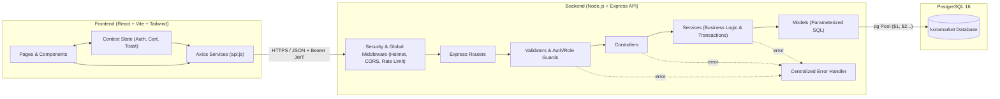

# KoraMarket — System Architecture

## 1. Architectural Style

KoraMarket uses a **three-tier decoupled web architecture**:

1. **Presentation Tier (`client/`):** React 19 + Vite Single Page Application styled with Tailwind CSS, communicating exclusively over JSON/HTTP via Axios.
2. **Application / API Tier (`server/`):** Stateless Node.js + Express RESTful API written in ES Modules (`"type": "module"`), authenticating requests via signed JWTs (`Authorization: Bearer <token>`).
3. **Data Tier (`database/` + PostgreSQL 16):** Normalized relational database accessed through `pg` (`node-postgres`) connection pooling and 100% parameterized SQL queries.



---

## 2. Backend Layered Responsibility Model

Keeping each layer focused makes the backend easy to debug, test, and scale:

| Layer | Directory | Responsibility | Must NOT Do |
|---|---|---|---|
| **Config** | `server/config/` | Load & validate env variables (`env.js`), initialize `pg.Pool` (`db.js`). | Contain business logic. |
| **Routes** | `server/routes/` | Declare URL paths, HTTP verbs, and chain middleware → validators → controller. | Execute SQL or format business rules. |
| **Validators** | `server/validators/` | Validate `req.body`, `req.params`, and `req.query` using `express-validator`. | Talk to HTTP responses directly (delegated to `validateRequest` middleware). |
| **Middleware** | `server/middleware/` | JWT verification, RBAC role guards, validation error aggregation, centralized `errorHandler`. | Duplicate route-specific logic. |
| **Controllers** | `server/controllers/` | Extract sanitized request data, call a service, send consistent JSON responses. | Write raw SQL queries. |
| **Services** | `server/services/` | Enforce business rules, hash passwords, manage multi-query DB transactions (`BEGIN/COMMIT/ROLLBACK`). | Depend on Express `req`/`res` objects. |
| **Models** | `server/models/` | Execute clean, parameterized SQL queries against PostgreSQL and return plain data rows. | Know about HTTP status codes or JWTs. |

### Why Separate `app.js` and `server.js`?
- `server/app.js` configures Express middleware, routes, and error handlers and exports `app` **without** binding a TCP port.
- `server/server.js` verifies the PostgreSQL connection and calls `app.listen(PORT)`.
- This separation allows `supertest` in `server/tests/` to test the full Express pipeline in-memory without port collisions!

---

## 3. Standard API Response Contract

Every endpoint returns a predictable JSON envelope so the frontend handles success and failure uniformly:

**Success:**
```json
{
  "success": true,
  "message": "Products fetched successfully",
  "data": { ... },
  "meta": {
    "page": 1,
    "limit": 12,
    "total": 48,
    "totalPages": 4
  }
}
```

**Error:**
```json
{
  "success": false,
  "message": "Validation failed",
  "errors": [
    { "field": "email", "message": "Please provide a valid email address" }
  ]
}
```

---

## 4. Frontend Architecture

### Routing & Layouts
- **`StorefrontLayout`:** Sticky navbar, main `<Outlet />`, slide-out CartDrawer, footer.
- **`AuthLayout`:** Clean centered card layout for Login and Registration.
- **`AdminLayout`:** Persistent sidebar navigation, admin topbar, protected by `<AdminRoute>` guard.

### State Management Strategy (React Context API)
1. **`AuthContext`:** Holds `user`, `token`, `isAuthenticated`, `isAdmin`, `loading`, and actions (`login`, `register`, `logout`, `refreshProfile`). Persists JWT in `localStorage` and attaches it via an Axios request interceptor.
2. **`CartContext`:** Seamless dual-mode cart:
   - *Guest user:* Persists items in `localStorage` (`koramarket_guest_cart`).
   - *Authenticated user:* Syncs with `/api/cart`. On login, automatically merges any guest cart items via `POST /api/cart/merge` so shoppers never lose items when signing in.
3. **`ToastContext`:** Non-intrusive success/error/info notifications across all user actions.

### Data Flow Example (Product Catalog)
`CatalogPage` (filter/sort/search state) → `useDebounce` → `productService.getProducts(params)` → Axios `GET /api/products?category=...&sort=...` → Express `productRoutes` → `productController` → `productService` → `productModel` (`pg` parameterized SQL) → PostgreSQL → JSON response → React state → `ProductCard` grid.

---

## 5. Security Controls Matrix

| Threat | Mitigation in KoraMarket |
|---|---|
| **SQL Injection** | 100% parameterized `pg` queries (`$1, $2`); dynamic sort columns strictly mapped through a hardcoded allowlist object. |
| **Password Compromise** | `bcryptjs` hashing with configurable salt rounds (`12`); `password_hash` is never returned in API JSON responses. |
| **Broken Access Control** | Backend `authenticate` + `authorize('admin')` middleware on every admin route; ownership checks on user orders and addresses (`WHERE id = $1 AND user_id = $2`). |
| **Brute-Force Login** | `express-rate-limit` throttling on `/api/auth/login` and `/api/auth/register`. |
| **XSS / Clickjacking / Sniffing** | `helmet()` HTTP security headers; React automatic JSX escaping; strict CORS `origin` allowlist (`CLIENT_URL`). |
| **Inventory Race Conditions** | Checkout runs inside a PostgreSQL transaction using `SELECT ... FOR UPDATE` row locks before verifying and decrementing `products.stock_quantity`. |
| **Broken Order History** | Deleting a product with existing `order_items` performs a soft-delete (`is_active = false`, `deleted_at = NOW()`) instead of deleting the row. |
