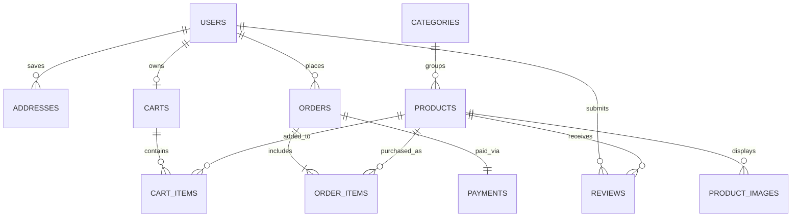

# KoraMarket — PostgreSQL Database Design

## 1. Relational Design Principles & Normalization

KoraMarket uses **PostgreSQL 16** with a strictly normalized schema through **Third Normal Form (3NF)**:

- **1NF (First Normal Form):** Every column stores an atomic value; repeating groups are extracted into dedicated child tables (e.g., `product_images` instead of comma-separated URLs, `order_items` instead of arrays).
- **2NF (Second Normal Form):** In junction tables (`cart_items`, `order_items`, `reviews`), every non-key attribute depends on the entire relationship, not just one half of it.
- **3NF (Third Normal Form):** Non-key attributes do not depend on other non-key attributes. For example, `products` stores only `category_id` (not duplicated category name or description).
- **Intentional Historical Snapshots (Domain Best Practice):** In e-commerce, product prices, product names, and user addresses change over time, but a past receipt must remain historically accurate. Therefore, `orders.shipping_address_snapshot` (`JSONB`) and `order_items.product_name_snapshot` / `unit_price_snapshot` deliberately freeze values at the exact moment an order is placed.

---

## 2. Entity-Relationship Diagram

---

## 3. Relationship Summary

| Cardinality | Entities | Implementation |
|---|---|---|
| **One-to-One (1:1)** | `users` ↔ `carts` | `carts.user_id` has both `FOREIGN KEY` and `UNIQUE` constraint (one persistent active cart per user). |
| **One-to-One (1:1)** | `orders` ↔ `payments` | `payments.order_id` has `FOREIGN KEY` and `UNIQUE` constraint (one payment record per order for MVP). |
| **One-to-Many (1:N)** | `users` → `addresses` | One user can save multiple shipping addresses. |
| **One-to-Many (1:N)** | `users` → `orders` | One customer can place many orders over time. |
| **One-to-Many (1:N)** | `categories` → `products` | One category contains many products. |
| **One-to-Many (1:N)** | `products` → `product_images` | One product can have multiple gallery images. |
| **One-to-Many (1:N)** | `orders` → `order_items` | One order contains one or more line items. |
| **Many-to-Many (M:N)** | `carts` ↔ `products` | Resolved via `cart_items` with `UNIQUE(cart_id, product_id)` and `quantity`. |
| **Many-to-Many (M:N)** | `orders` ↔ `products` | Resolved via `order_items` storing `quantity` and price/name snapshots. |
| **Many-to-Many (M:N)** | `users` ↔ `products` | Resolved via `reviews` with `UNIQUE(user_id, product_id)` so each customer reviews a product at most once. |

---

## 4. Table Definitions (11 Entities)

### 1. `users`
Stores customer and administrator accounts.
- **PK:** `id SERIAL PRIMARY KEY`
- **Columns:** `full_name VARCHAR(120) NOT NULL`, `email VARCHAR(255) NOT NULL UNIQUE`, `password_hash VARCHAR(255) NOT NULL`, `phone VARCHAR(30)`, `role VARCHAR(20) NOT NULL DEFAULT 'customer'`, `is_active BOOLEAN NOT NULL DEFAULT TRUE`, `created_at TIMESTAMPTZ`, `updated_at TIMESTAMPTZ`
- **Constraints:** `CHECK (role IN ('customer', 'admin'))`

### 2. `addresses`
Stores reusable customer shipping addresses.
- **PK:** `id SERIAL PRIMARY KEY`
- **FK:** `user_id INTEGER NOT NULL REFERENCES users(id) ON DELETE CASCADE`
- **Columns:** `label VARCHAR(50)`, `recipient_name VARCHAR(120) NOT NULL`, `phone VARCHAR(30) NOT NULL`, `street_line1 VARCHAR(255) NOT NULL`, `street_line2 VARCHAR(255)`, `city VARCHAR(100) NOT NULL`, `state VARCHAR(100) NOT NULL`, `postal_code VARCHAR(30) NOT NULL`, `country VARCHAR(100) NOT NULL DEFAULT 'United States'`, `is_default BOOLEAN NOT NULL DEFAULT FALSE`, `created_at`, `updated_at`

### 3. `categories`
Organizes products into storefront departments.
- **PK:** `id SERIAL PRIMARY KEY`
- **Columns:** `name VARCHAR(100) NOT NULL UNIQUE`, `slug VARCHAR(120) NOT NULL UNIQUE`, `description TEXT`, `image_url TEXT`, `created_at`, `updated_at`

### 4. `products`
Core catalog items with inventory tracking and soft-delete safeguards.
- **PK:** `id SERIAL PRIMARY KEY`
- **FK:** `category_id INTEGER NOT NULL REFERENCES categories(id) ON DELETE RESTRICT`
- **Columns:** `name VARCHAR(180) NOT NULL`, `slug VARCHAR(200) NOT NULL UNIQUE`, `sku VARCHAR(64) NOT NULL UNIQUE`, `short_description VARCHAR(300)`, `description TEXT NOT NULL`, `price NUMERIC(10,2) NOT NULL`, `compare_at_price NUMERIC(10,2)`, `stock_quantity INTEGER NOT NULL DEFAULT 0`, `low_stock_threshold INTEGER NOT NULL DEFAULT 5`, `is_featured BOOLEAN NOT NULL DEFAULT FALSE`, `is_active BOOLEAN NOT NULL DEFAULT TRUE`, `deleted_at TIMESTAMPTZ`, `created_at`, `updated_at`
- **Constraints:** `CHECK (price >= 0)`, `CHECK (compare_at_price IS NULL OR compare_at_price >= price)`, `CHECK (stock_quantity >= 0)`

### 5. `product_images`
Stores one or more images per product for gallery viewing.
- **PK:** `id SERIAL PRIMARY KEY`
- **FK:** `product_id INTEGER NOT NULL REFERENCES products(id) ON DELETE CASCADE`
- **Columns:** `image_url TEXT NOT NULL`, `alt_text VARCHAR(200)`, `is_primary BOOLEAN NOT NULL DEFAULT FALSE`, `sort_order INTEGER NOT NULL DEFAULT 0`, `created_at`

### 6. `carts`
Persistent active cart container per registered customer.
- **PK:** `id SERIAL PRIMARY KEY`
- **FK:** `user_id INTEGER NOT NULL UNIQUE REFERENCES users(id) ON DELETE CASCADE`
- **Columns:** `created_at`, `updated_at`

### 7. `cart_items`
Line items inside a user's shopping cart.
- **PK:** `id SERIAL PRIMARY KEY`
- **FKs:** `cart_id INTEGER NOT NULL REFERENCES carts(id) ON DELETE CASCADE`, `product_id INTEGER NOT NULL REFERENCES products(id) ON DELETE CASCADE`
- **Columns:** `quantity INTEGER NOT NULL`, `created_at`, `updated_at`
- **Constraints:** `UNIQUE (cart_id, product_id)`, `CHECK (quantity > 0)`

### 8. `orders`
Immutable order headers with financial breakdown and shipping snapshot.
- **PK:** `id SERIAL PRIMARY KEY`
- **FK:** `user_id INTEGER NOT NULL REFERENCES users(id) ON DELETE RESTRICT`
- **Columns:** `order_number VARCHAR(40) NOT NULL UNIQUE`, `status VARCHAR(25) NOT NULL DEFAULT 'pending'`, `subtotal NUMERIC(10,2) NOT NULL`, `shipping_fee NUMERIC(10,2) NOT NULL DEFAULT 0`, `tax_amount NUMERIC(10,2) NOT NULL DEFAULT 0`, `total_amount NUMERIC(10,2) NOT NULL`, `shipping_address_snapshot JSONB NOT NULL`, `notes TEXT`, `created_at`, `updated_at`
- **Constraints:** `CHECK (status IN ('pending', 'confirmed', 'processing', 'shipped', 'delivered', 'cancelled'))`, `CHECK (subtotal >= 0 AND shipping_fee >= 0 AND tax_amount >= 0 AND total_amount >= 0)`

### 9. `order_items`
Line items frozen at checkout time.
- **PK:** `id SERIAL PRIMARY KEY`
- **FKs:** `order_id INTEGER NOT NULL REFERENCES orders(id) ON DELETE CASCADE`, `product_id INTEGER NOT NULL REFERENCES products(id) ON DELETE RESTRICT`
- **Columns:** `product_name_snapshot VARCHAR(180) NOT NULL`, `product_sku_snapshot VARCHAR(64) NOT NULL`, `product_image_snapshot TEXT`, `unit_price_snapshot NUMERIC(10,2) NOT NULL`, `quantity INTEGER NOT NULL`, `line_total NUMERIC(10,2) NOT NULL`
- **Constraints:** `CHECK (unit_price_snapshot >= 0)`, `CHECK (quantity > 0)`, `CHECK (line_total >= 0)`

### 10. `payments`
Tracks Cash on Delivery or Simulated Demo Payment status per order.
- **PK:** `id SERIAL PRIMARY KEY`
- **FK:** `order_id INTEGER NOT NULL UNIQUE REFERENCES orders(id) ON DELETE CASCADE`
- **Columns:** `payment_method VARCHAR(30) NOT NULL`, `payment_status VARCHAR(30) NOT NULL DEFAULT 'pending'`, `amount NUMERIC(10,2) NOT NULL`, `transaction_ref VARCHAR(100) UNIQUE`, `paid_at TIMESTAMPTZ`, `created_at`, `updated_at`
- **Constraints:** `CHECK (payment_method IN ('cash_on_delivery', 'simulated_card'))`, `CHECK (payment_status IN ('pending', 'simulated_paid', 'failed', 'refunded'))`, `CHECK (amount >= 0)`

### 11. `reviews`
Customer star ratings and written reviews per product.
- **PK:** `id SERIAL PRIMARY KEY`
- **FKs:** `user_id INTEGER NOT NULL REFERENCES users(id) ON DELETE CASCADE`, `product_id INTEGER NOT NULL REFERENCES products(id) ON DELETE CASCADE`
- **Columns:** `rating SMALLINT NOT NULL`, `title VARCHAR(150)`, `comment TEXT NOT NULL`, `created_at`, `updated_at`
- **Constraints:** `UNIQUE (user_id, product_id)`, `CHECK (rating BETWEEN 1 AND 5)`

---

## 5. Planned Indexes & Triggers

- **Indexes:** Foreign key indexes on `addresses(user_id)`, `products(category_id)`, `product_images(product_id)`, `cart_items(cart_id)`, `orders(user_id)`, `order_items(order_id)`, `reviews(product_id)`; composite query indexes on `products(is_active, price)` and `orders(status, created_at DESC)`.
- **Trigger:** Shared PL/pgSQL function `set_updated_at()` attached via `BEFORE UPDATE` triggers on all tables containing `updated_at`.
